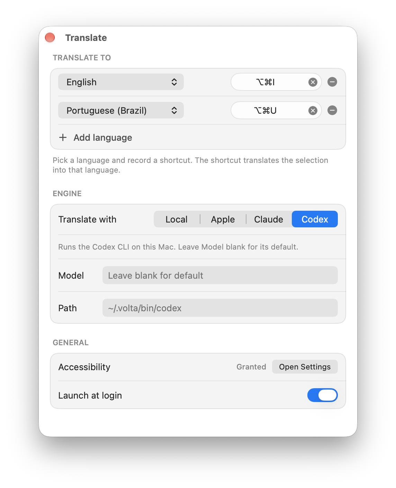

# Translate

A menu bar translator for Mac.
Select text, press a shortcut, and replace it where it was.

The translation shows in a small overlay.
Return replaces the selection.
⌘C copies.
The field you were in keeps focus.

`branch` stays `branch`.
Portuguese means Brazilian Portuguese, not Spanish.

## The loop

Select text in any app Accessibility can read, then press the shortcut.
The translation appears in a compact popover next to the selection.
Press Return to replace the text, or ⌘C to copy.


Default shortcuts are ⌘⌥I (English) and ⌘⌥U (Portuguese).
Record your own in Settings.

## Settings

Pick a language, record its shortcut, and choose the translation engine.
Settings follows the macOS light or dark appearance.



## Engines

- **Local** — Qwen3-4B on MLX at `127.0.0.1:8765`. Offline, streamed.
- **Apple Translate** — on-device, the same engine as Apple's Translate app.
- **Claude** / **Codex** — the CLIs you already have.

Claude and Local stream tokens into the overlay as they arrive.
Apple Translate fills it in paragraph by paragraph.
Codex shows only its final message, so the overlay keeps loading until Codex finishes.

Start the local server with `local-translate-server start` if you use Local.

### Isolated CLI calls

Claude and Codex run as plain one-shot translators, not coding agents: no tools, skills, plugins, MCP servers, hooks, sub-agents, AGENTS.md or CLAUDE.md.
The app sends only its translation system prompt and the text; Claude may still add fixed SDK metadata of its own to the request.
Your installed CLI, its sign-in and the model from Settings are kept; a blank model means the CLI's built-in default.

- **Claude** runs with `--tools ""`, `--strict-mcp-config` and an empty `--mcp-config`, `--setting-sources ""`, `--safe-mode`, `--disable-slash-commands`, no session persistence and low effort.
  Not `--bare`, which can't use a subscription login.
- **Codex** runs `exec` ignoring your `config.toml` and rules, ephemeral and read-only, with web search and every tool, agent, skill, plugin, app, hook and goal feature off.
  Codex's model catalog also turns on code mode, sub-agents and experimental tools, so on the first Codex translation the app reads the catalog once with `codex debug models --bundled` (the bundled local catalog, never refreshed remotely; no generation), strips that machinery from every model and passes the copy with `model_catalog_json`.
  The system prompt replaces Codex's agent instructions through `model_instructions_file`.
  The copy lasts until the app quits, so a Codex update is picked up on the next launch.
  A model the catalog doesn't list fails instead of falling back to Codex's agent setup.
- Both CLIs start under `sandbox-exec` with a profile that denies reading any `AGENTS.md`, `AGENTS.override.md`, `CLAUDE.md` or `SKILL.md`, because some still load from your home directory regardless of flags.
  Everything else, including sign-in, works as usual.
- The child environment keeps only runtime, locale, temp, proxy and certificate variables plus the CLIs' own config roots and credentials, so agent session, tool-bridge and memory tokens, `SSH_AUTH_SOCK` and startup hooks like `NODE_OPTIONS` never reach them.

If `sandbox-exec`, a flag, or the catalog isn't available, the translation fails rather than running with tools.
Low effort and one-shot requests keep calls small, but there's no wall-clock guarantee, and each CLI still has its own startup, sign-in and system overhead.

## Clipboard

Translate reads the selection through Accessibility when the app exposes it.
Otherwise it copies the selection with ⌘C, and the source text stays on the clipboard as if you had copied it.
If the app, field or selection changes while copying, or the copy doesn't match the selection the app reports, nothing is translated.

Replacing writes through Accessibility when it can, which leaves the clipboard alone.
Otherwise it pastes with ⌘V.
Your previous clipboard comes back only after Accessibility confirms the pasted text; when nothing can confirm it, the translation stays on the clipboard.

## Build

Needs macOS 14+.
Install the `.app` into `/Applications` so Accessibility sticks to a stable path.

```bash
xcodegen generate
xcodebuild -scheme Translate \
  -destination 'platform=macOS,arch=arm64' \
  -configuration Debug \
  CONFIGURATION_BUILD_DIR="$PWD/build" \
  build
ditto build/Translate.app /Applications/Translate.app
xattr -cr /Applications/Translate.app
open /Applications/Translate.app
```

Turn Translate on in System Settings → Privacy & Security → Accessibility.
Select some text and press the shortcut.

## Test

```bash
scripts/test.sh
```

Runs the offline suite: no models, no signing, nothing installed.
Tests make no network calls; Swift Package Manager may still need the network to resolve dependencies on a first build.
Process lifecycle tests run small fake shell scripts in a temporary directory, never the installed CLIs.
CLI isolation tests launch those fakes through the real `Translator` and `sandbox-exec` and check the arguments, environment and file reads they actually get.
Live eval and snapshot variables are unset, raw or `TEST_RUNNER_`-prefixed, so they can't turn those on.
Pass xcodebuild arguments through, e.g. `scripts/test.sh -only-testing:TranslateTests/CLIProcessTests`.
`DERIVED_DATA` and `TEST_LOG` choose where the build and log go.

The live translation eval is separate and opt-in; see [docs/translation-eval.md](docs/translation-eval.md).
