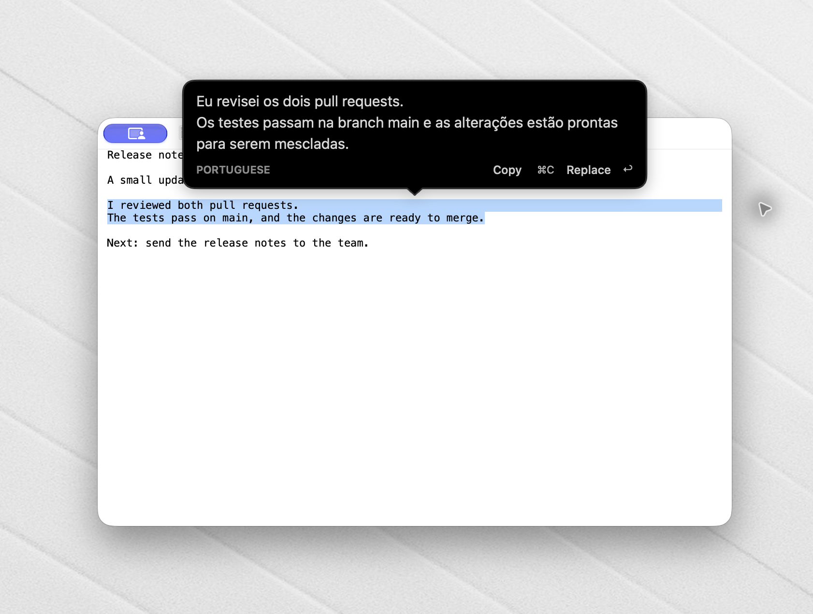
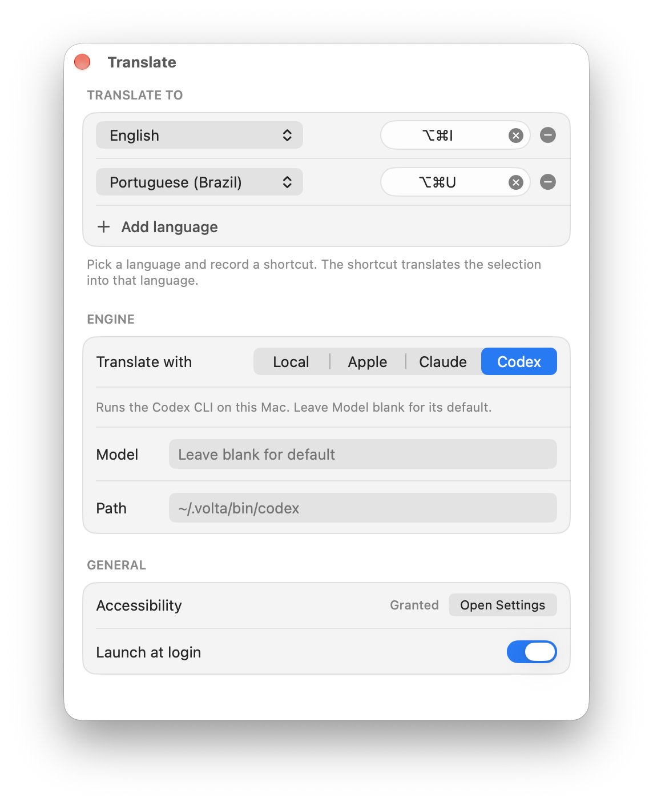

# Translate

A menu bar translator for Mac.
Select text, press a shortcut, and replace it where it was.

The translation shows in a small overlay.
Return replaces the selection.
⌘C copies.
The field you were in keeps focus.

`branch` stays `branch`.
Portuguese means Brazilian Portuguese, not Spanish.

## The loop

Select text in any app Accessibility can read, then press the shortcut.
The translation appears in a compact popover next to the selection.
Press Return to replace the text, or ⌘C to copy.



Default shortcuts are ⌘⌥I (English) and ⌘⌥U (Portuguese).
Record your own in Settings.

## Settings

Pick a language, record its shortcut, and choose the translation engine.
Settings follows the macOS light or dark appearance.



## Engines

- **Local** — Qwen3-4B on MLX at `127.0.0.1:8765`. Offline, streamed.
- **Apple Translate** — on-device, the same engine as Apple's Translate app.
- **Claude** / **Codex** — the CLIs you already have.

Claude and Local stream tokens into the overlay as they arrive.
Apple Translate fills it in paragraph by paragraph.
Codex shows only its final message, so the overlay keeps loading until Codex finishes.

Start the local server with `local-translate-server start` if you use Local.

### Isolated CLI calls

Claude and Codex run as plain one-shot translators, not coding agents: no tools, skills, plugins, MCP servers, hooks, sub-agents, AGENTS.md or CLAUDE.md.
The app sends only its translation system prompt and the text; Claude may still add fixed SDK metadata of its own to the request.
Your installed CLI, its sign-in and the model from Settings are kept; `CLI default` passes no model, so the CLI picks.

- **Claude** runs with `--tools ""`, `--strict-mcp-config` and an empty `--mcp-config`, `--setting-sources ""`, `--safe-mode`, `--disable-slash-commands`, no session persistence and low effort.
  Not `--bare`, which can't use a subscription login.
- **Codex** runs `exec` ignoring your `config.toml` and rules, ephemeral and read-only, with web search and every tool, agent, skill, plugin, app, hook and goal feature off.
  Codex's model catalog also turns on code mode, sub-agents and experimental tools, so the app strips that machinery from every model and passes the copy with `model_catalog_json`.
  The copy comes from the current catalog Settings last loaded and saved (see [Models and Fast](#models-and-fast)), sanitized again whenever it's read back; without a usable saved catalog, the first Codex translation reads the catalog bundled with the CLI once with `codex debug models --bundled` (local, no network, no generation).
  Codex's agent instructions are emptied for every model and the system prompt goes in once, as the developer message, so the request is exactly the prompt and the text (`model_instructions_file` makes Codex 0.167 send the prompt twice).
  The copy lasts until the app quits or Settings refreshes it.
  A model the catalog doesn't list fails instead of falling back to Codex's agent setup.
- Both CLIs start under `sandbox-exec` with a profile that denies reading any `AGENTS.md`, `AGENTS.override.md`, `CLAUDE.md` or `SKILL.md`, because some still load from your home directory regardless of flags.
  Everything else, including sign-in, works as usual.
- The child environment keeps only runtime, locale, temp, proxy and certificate variables plus the CLIs' own config roots and credentials, so agent session, tool-bridge and memory tokens, `SSH_AUTH_SOCK` and startup hooks like `NODE_OPTIONS` never reach them.

If `sandbox-exec`, a flag, or the catalog isn't available, the translation fails rather than running with tools.
Low effort and one-shot requests keep calls small, but there's no wall-clock guarantee, and each CLI still has its own startup, sign-in and system overhead.

### Models and Fast

While Settings is open on Claude or Codex, the app asks that CLI which models it offers, under the same sandbox, flags and filtered environment as a translation, and without sending a message to any model:

- **Claude** gets one SDK `initialize` request on stdin, then EOF. Only model IDs, names and whether each supports Fast are kept; account, commands and the rest of the response are dropped and never logged.
- **Codex** runs `codex debug models`, which may fetch the current catalog. Models the CLI hides are left out of the picker. The same catalog becomes the sanitized copy translations use, so a model newer than the CLI's bundled catalog works once Settings has loaded it.

Each list is saved per resolved executable in `~/Library/Caches/com.frank.translate/Models` (owner-only files), shown at once the next time and refreshed once per app session while Settings is open; the refresh button asks again.
A saved entry only counts while the executable file is unchanged, so an updated binary lists again; a CLI behind a version-manager shim (like Volta's) keeps the same file, so use refresh after updating it.
Changing the path asks the new executable; an answer for the old one never lands on the new one.
If a query fails or times out (30 s), the last list stays and the saved model is never changed.
`CLI default` comes first, named after the model the CLI would use.
A saved model the list doesn't include stays selected as its own entry.

Fast is a separate switch for each CLI, off until you turn it on.
It applies only to models whose metadata says they support it, and choosing a model never turns it on or off.
Every call states the speed explicitly: Claude gets `--settings '{"fastMode":true|false}'`; Codex gets `service_tier="priority"` with `features.fast_mode=true`, or `service_tier="default"` with it off, so a catalog default can't switch Fast on.
Claude bills Fast as extra usage, outside plan limits; Codex Fast uses more of your plan's usage.
Metadata only says a model supports Fast, not that your account can use it; the CLI and your account decide that.

Translations use the saved lists, so a newer model and Fast keep working after a relaunch without opening Settings.
With no usable saved list, Claude runs at Standard speed and Codex uses its bundled catalog, which refuses models it doesn't list.
Codex checks Fast against the catalog it translates with.

## Clipboard

Translate reads the selection through Accessibility when the app exposes it.
Otherwise it copies the selection with ⌘C, and the source text stays on the clipboard as if you had copied it.
If the app, field or selection changes while copying, or the copy doesn't match the selection the app reports, nothing is translated.

Replacing always pastes the translation once with ⌘V, after checking that the app, field and selection are still the ones you translated.
Accessibility writes are not used, because some apps report success without changing anything.
Your previous clipboard comes back only after Accessibility confirms the pasted text; when nothing can confirm it, the translation stays on the clipboard.
If the app still shows the original text after the paste, Translate reports that the replacement failed instead of closing silently.

## Build

Needs macOS 14+.
Install the `.app` into `/Applications` so Accessibility sticks to a stable path.

```bash
xcodegen generate
xcodebuild -scheme Translate \
  -destination 'platform=macOS,arch=arm64' \
  -configuration Debug \
  CONFIGURATION_BUILD_DIR="$PWD/build" \
  build
ditto build/Translate.app /Applications/Translate.app
xattr -cr /Applications/Translate.app
open /Applications/Translate.app
```

Turn Translate on in System Settings → Privacy & Security → Accessibility.
Select some text and press the shortcut.

## Test

```bash
scripts/test.sh
```

Runs the offline suite: no models, no signing, nothing installed.
Tests make no network calls; Swift Package Manager may still need the network to resolve dependencies on a first build.
Process lifecycle tests run small fake shell scripts in a temporary directory, never the installed CLIs.
CLI isolation tests launch those fakes through the real `Translator` and `sandbox-exec` and check the arguments, environment and file reads they actually get, including the explicit speed for each model.
Model-list tests use fakes too; Settings snapshots render offscreen and never launch a CLI.
Live eval and snapshot variables are unset, raw or `TEST_RUNNER_`-prefixed, so they can't turn those on.
Pass xcodebuild arguments through, e.g. `scripts/test.sh -only-testing:TranslateTests/CLIProcessTests`.
`DERIVED_DATA` and `TEST_LOG` choose where the build and log go.

The live translation eval is separate and opt-in; see [docs/translation-eval.md](docs/translation-eval.md).
